[andriidrok.com](https://andriidrok.com) &nbsp;·&nbsp;
[instagram](https://www.instagram.com/andrii_drok/) &nbsp;·&nbsp;
[linkedin](https://www.linkedin.com/in/andriidrok/) &nbsp;·&nbsp;
[email](mailto:clb@mirasvit.com)

> Andrii Drok. CS student at San Francisco State University, San Francisco Bay Area. 
> Small, sharp tools over big vague ideas.

I build fast, test on real users, and kill what doesn't work. Right now that's 
[autobroll](https://github.com/andriidrok1/autobroll) — an AI short-form video editor that runs in the browser. Also 
deep into markets: Pine Script indicators, backtesting, on-chain data.

<samp>python &nbsp; typescript &nbsp; javascript &nbsp; react &nbsp; node &nbsp; three.js &nbsp; fastapi &nbsp; postgres &nbsp; docker &nbsp; git &nbsp; linux</samp>

**[autobroll](https://github.com/andriidrok1/autobroll)** &nbsp;·&nbsp; <samp>typescript, remotion</samp> 
AI short-form video editor in the browser. Auto captions with accents, 
drag-and-retime editing, b-roll placement: transcript in, rendered video out.

**[strategy-checker](https://github.com/andriidrok1/strategy-checker)** &nbsp;·&nbsp; <samp>python</samp> 
Describe a trading strategy in plain English, get a real backtest with 
statistical validation. Exposes curve-fitting, not alpha.

**[compound](https://github.com/andriidrok1/compound)** &nbsp;·&nbsp; <samp>typescript, convex</samp> 
Autonomous research agent for your second brain. Built solo at Nozomio 
Hackathon, EF SF.

**[andriidrok.com](https://andriidrok.com)** &nbsp;·&nbsp; <samp>three.js, webgl</samp> 
Particle-morph portfolio: thousands of particles reshaping between scenes.

Every graphic here is generated, not embedded from anyone else's server. 
`ascii.svg` is a photo pushed through a character ramp by 
[`scripts/make_portrait.py`](scripts/make_portrait.py); the stat graphics and 
these section headings are drawn by [a scheduled action](.github/workflows/stats.yml) 
straight from the GitHub GraphQL API, once a day, committing only what changed.

They animate with SMIL inside the SVG, because GitHub strips scripts from 
READMEs — and since nothing loads from a third party, nothing here can 
rate-limit or go dark. The headings are SVGs for the same reason: GitHub also 
strips CSS, so an image is the only way to put this page's own typeface on them.

The typeface is [JetBrains Mono](scripts/fonts), subset to just the characters 
each graphic draws and inlined as base64. That isn't only for looks: the 
portrait's grid assumes an advance width of exactly 0.600 em, and a viewer whose 
default monospace is narrower would otherwise see it squeezed.

Language totals cover public repositories only. `year.svg` uses the portrait's 
character ramp: `:` `+` `#` `@`, quiet to loud.

The full write-up, with the gotchas and how to reuse it, is in 
[how-this-page-is-built.md](how-this-page-is-built.md).
